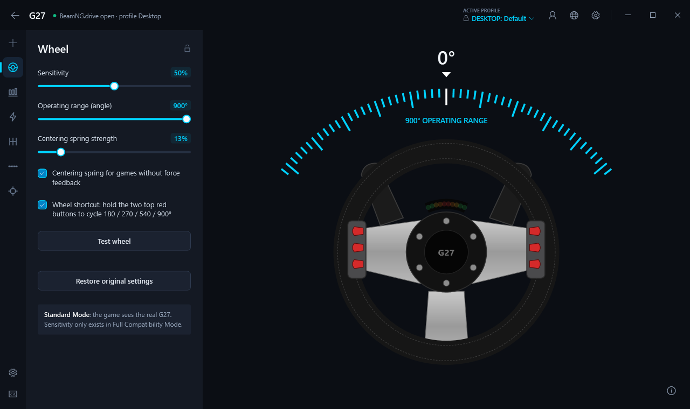
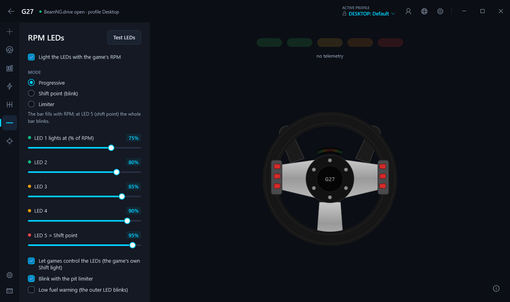
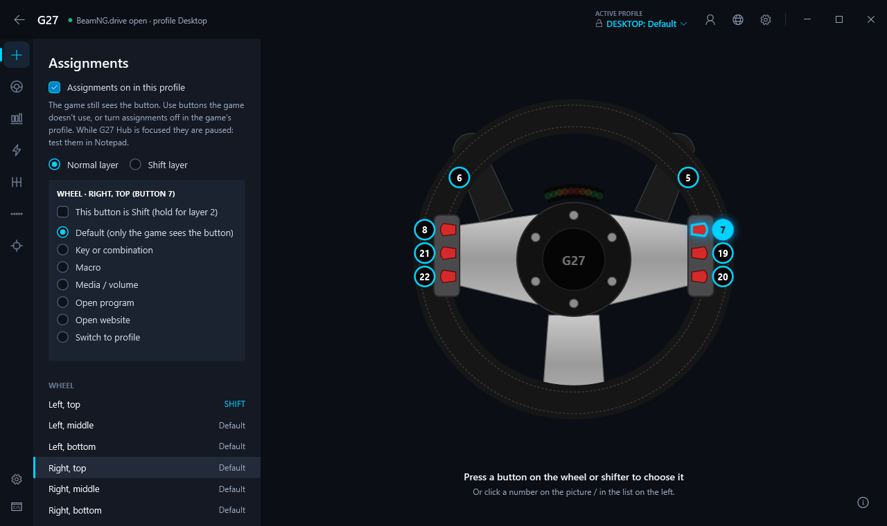
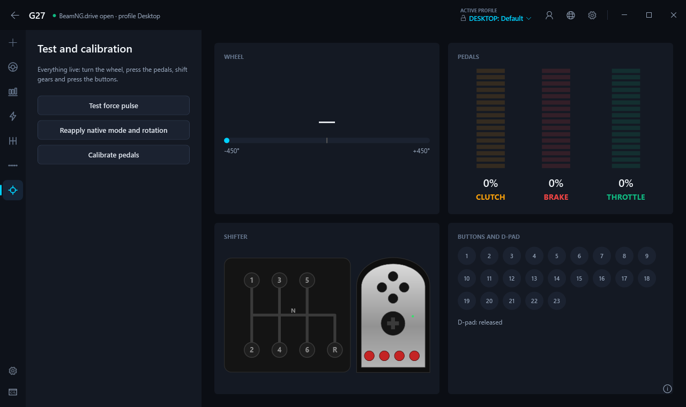
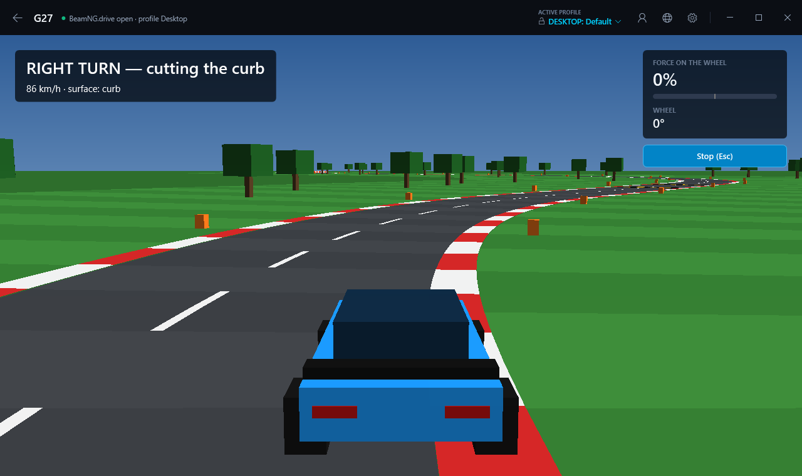
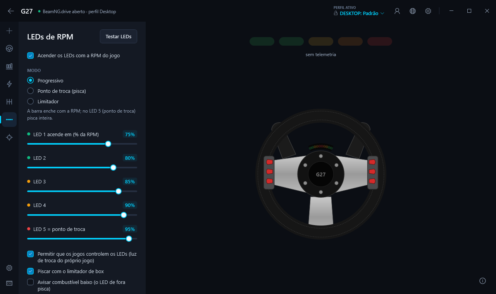
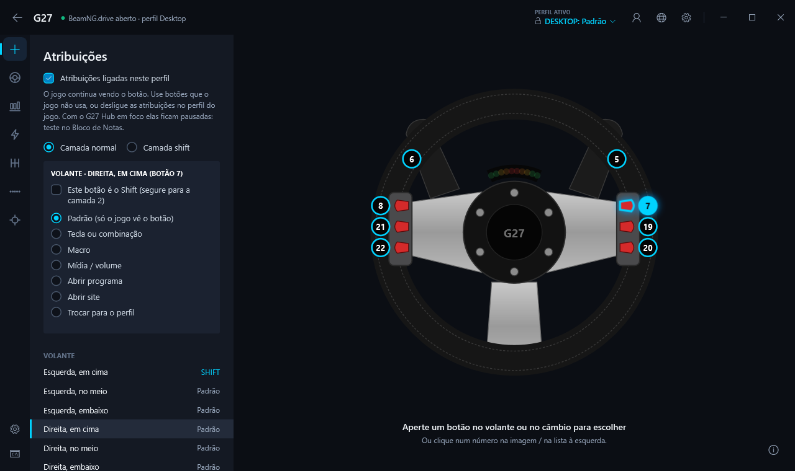
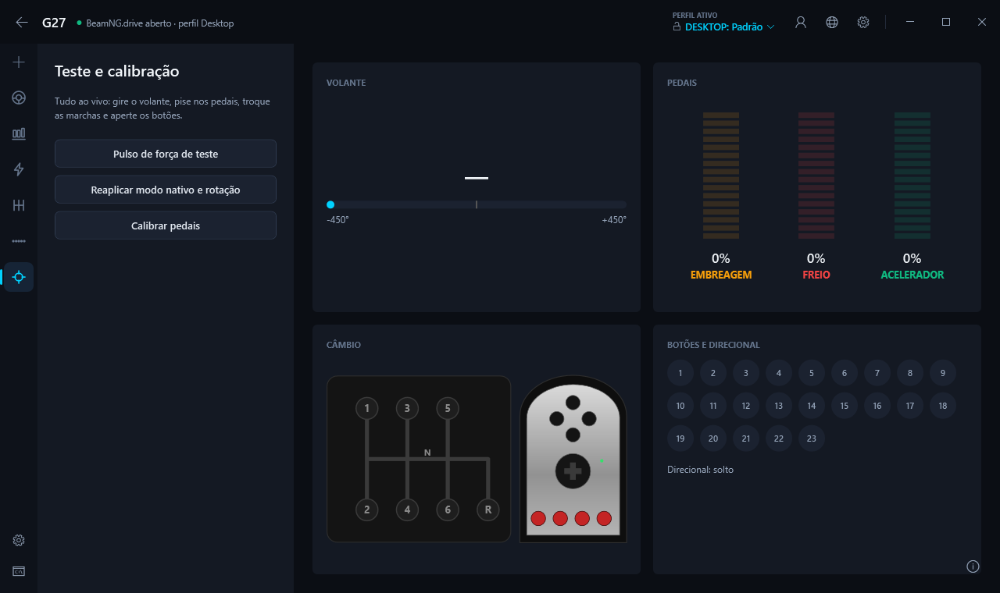

# G27 Hub

**[English](#english) · [Português](#português)**



---

## English

G27 Hub brings the **Logitech G27** back to life on **Windows 10/11** without Logitech Gaming Software: it does what
LGS 5.10 used to do, with a look inspired by G HUB. The app is available in **English and Portuguese** (globe button at the top).

**Conceived and developed by John Salim / Samosbourne, together with AI** (Claude, by Anthropic): the code was written
with artificial intelligence, based on John's ideas, decisions and tests on his own wheel.

A personal project, not affiliated with Logitech. "G27" and "Logitech" are trademarks of Logitech; no code, icons or images
from LGS/G HUB were used.

### Download
1. Download `G27Hub-Setup-<version>.exe` from **[Releases](https://github.com/Samosbourne/G27Hub/releases/latest)**.
2. Run it. It installs for your user only, **no administrator needed**.
3. The installer is not signed, so Windows may show "Windows protected your PC": click **More info → Run anyway**.

A first-run wizard checks old Logitech drivers, switches the wheel to native mode, enables force feedback and tests the LEDs.

### Features
- **Automatic native mode** every time the wheel is plugged in: 900°, separate pedals, clutch and H-shifter.
- **Force feedback** for 32- and 64-bit games through a DirectInput effect driver that runs **in user mode**: no kernel driver,
  works with Memory Integrity (Core Isolation) turned on. Strength, spring, damper, minimum force, center force and invert, per profile.
- **Per-game profiles** that switch automatically when the game starts; a lock to pin one profile.
- **Button assignments**: keys, combos, macros, media, open program/website, shift layer, pedal as a key,
  H-shifter as sequential, rotation shortcut on the wheel.
- **RPM LEDs** from game telemetry: BeamNG.drive (own mod), ETS2/ATS (own plugin), Assetto Corsa/ACC, F1 22–25, Forza and Live for Speed.
- **Game detector** (optional) with a compatibility database and per-game tips; automatic fix for BeamNG's controls.
- **Full Compatibility Mode** (optional, off by default): vJoy + HidHide for games that do not accept the G27,
  with sensitivity curves, combined pedals and force feedback routed back to the G27.
- **Pedal calibration** saved in Windows itself (applies to every game), **wheel test** like LGS, and a 3D mini-game to feel the force feedback.
- **Diagnostic console** (Ctrl+Shift+L) logging everything, with quick tests.

**Coming in 1.1 (in testing):** extra vibration from telemetry (engine, curbs, ABS, gear shifts, crashes), boost for weak forces,
a phone dashboard over Wi-Fi (RPM, gear, LEDs, switch profile/rotation/strength) and an optional new-version notice.

### Screenshots
| | |
|---|---|
|  |  |
|  |  |

### Good to know
- **Standard Mode** (default) writes only to your user registry (HKCU), without admin, and everything can be undone from the app.
  Uninstalling removes the force feedback driver, the game mods/plugins and autostart.
- Some antivirus programs may flag the unsigned force feedback DLL (`g27ffb.dll`) by **heuristics** (a false positive).
  The full source code is in this repository. If it happens, restore the file and add an exception, otherwise force feedback stops working.
- Your data: settings in `%APPDATA%\G27Hub\config.json`, logs in `%LOCALAPPDATA%\G27Hub\logs\`.

---

## Português

O G27 Hub faz o **Logitech G27** voltar a funcionar no **Windows 10/11** sem o Logitech Gaming Software: faz o que o LGS 5.10
fazia, com um visual inspirado no G HUB. O app está em **português e inglês** (botão do globo no topo).

**Idealizado e desenvolvido por John Salim / Samosbourne, junto com IA** (Claude, da Anthropic): o código deste projeto
foi escrito com inteligência artificial, a partir das ideias, decisões e testes no volante do John.

Projeto pessoal, sem relação com a Logitech. "G27" e "Logitech" são marcas da Logitech; nenhum código, ícone ou imagem do LGS/G HUB foi usado.

### Baixar
1. Baixe o `G27Hub-Setup-<versão>.exe` em **[Releases](https://github.com/Samosbourne/G27Hub/releases/latest)**.
2. Execute. Ele instala só para o seu usuário, **sem administrador**.
3. Como o instalador não é assinado, o Windows pode mostrar "O Windows protegeu o computador": clique em **Mais informações → Executar assim mesmo**.

Na primeira abertura, um assistente confere drivers antigos da Logitech, coloca o volante no modo nativo, ativa o force feedback e testa os LEDs.

### O que faz
- **Modo nativo automático** a cada vez que o volante é ligado: 900°, pedais separados, embreagem e câmbio H.
- **Force feedback** para os jogos (32 e 64 bits) por um driver de efeitos DirectInput que roda **em modo usuário**:
  sem driver de kernel, funciona com a Integridade de Memória ligada. Intensidade, mola, amortecedor, força mínima,
  força central e inverter, por perfil.
- **Perfis por jogo**, trocados sozinhos quando o jogo abre; cadeado para fixar um perfil.
- **Atribuições**: teclas, combinações, macros, mídia, abrir programa/site, camada shift, pedal como tecla,
  câmbio H como sequencial, atalho de rotação no volante.
- **LEDs de RPM** com a telemetria dos jogos: BeamNG.drive (mod próprio), ETS2/ATS (plugin próprio), Assetto Corsa/ACC,
  F1 22–25, Forza e Live for Speed.
- **Detector de jogos** (opcional) com base de compatibilidade e dicas por jogo; correção automática dos controles do BeamNG.
- **Modo Compatibilidade Total** (opcional, desligado de fábrica): vJoy + HidHide para jogos que não aceitam o G27,
  com sensibilidade, pedais combinados e force feedback de volta ao G27.
- **Calibração dos pedais** gravada no próprio Windows (vale para todos os jogos), **teste do volante** como no LGS e um minijogo 3D para sentir o force feedback.
- **Console de diagnóstico** (Ctrl+Shift+L) com log de tudo e testes rápidos.

**Na versão 1.1 (em teste):** vibração extra pela telemetria (motor, zebras, ABS, trocas de marcha, batidas), reforço das
forças fracas, painel no celular pelo Wi-Fi (RPM, marcha, LEDs, trocar perfil/rotação/força) e aviso opcional de versão nova.

### Telas
| | |
|---|---|
|  |  |
|  |  |

### Bom saber
- O **Modo Padrão** (de fábrica) grava só no registro do seu usuário (HKCU), sem administrador, e tudo pode ser desfeito pelo app.
  Desinstalar remove o driver de force feedback, os mods/plugins dos jogos e o início com o Windows.
- Alguns antivírus podem marcar a DLL de force feedback (`g27ffb.dll`), que não é assinada, por **heurística** (falso positivo).
  O código completo está neste repositório. Se acontecer, restaure o arquivo e crie uma exceção; sem ele o force feedback para.
- Seus dados: configurações em `%APPDATA%\G27Hub\config.json`, logs em `%LOCALAPPDATA%\G27Hub\logs\`.

---

## Development / Desenvolvimento
Requirements / Requisitos: .NET 10 SDK; for the native code, Visual Studio Build Tools with C++ (CMake included).

```
.\src\native\build.ps1   # force feedback DLL, g27fftest and ETS2 plugin (x64/x86)
dotnet build
.\g27hub                 # run the app / abre o app
.\g27cli list            # command-line tool / ferramenta de linha de comando
dotnet test
.\installer\build.ps1    # installer / instalador (Inno Setup 6)
```

Docs (Portuguese): `PLANO_G27HUB.md` (plan), `docs/protocolo-g27.md` (G27 HID protocol), `docs/testes/` (test scripts per phase).

## Credits / Créditos
- **gcampa/g27-ffb-driverless** (MIT): base of the DirectInput effect driver in `src/native/g27ffb` (see `LICENSE-gcampa.txt`).
- **SCS Software, SCS SDK** (MIT): telemetry SDK headers in `src/native/scssdk` (see `LICENSE-scssdk.txt`).
- **vJoy** (Shaul Eizikovich, njz3, BrunnerInnovation): virtual wheel for Full Compatibility Mode, installed by its official
  installer; force feedback structures follow its SDK (MIT).
- **HidHide** (Nefarius Software Solutions): hides the G27 from games in Full Compatibility Mode, installed by its official installer.
- **HidSharp** (James F. Bellinger, Apache 2.0): HID access to the wheel.
- **Serilog** (Apache 2.0): file logging.
- **QRCoder** (Raffael Herrmann, MIT): QR code for the phone dashboard.
- **Linux hid-lg4ff**: used only as a reference for G27 protocol facts (no GPL code copied).
- Feature ideas: **Jabelius/OpenG27** (MIT).

## License / Licença
MIT (see / ver `LICENSE`). © 2026 John Salim (Samosbourne).
